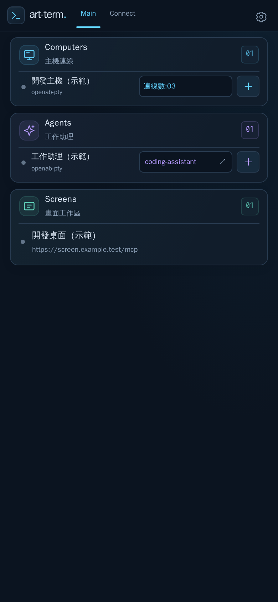
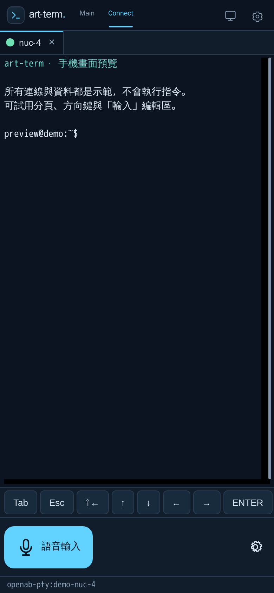
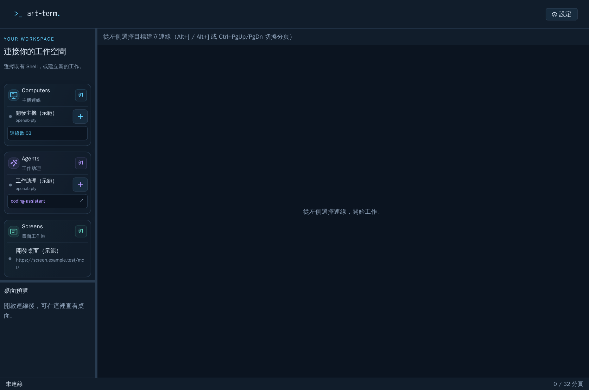
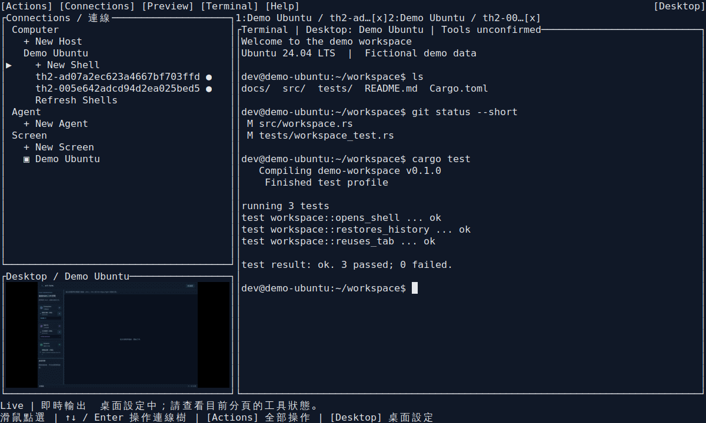

# art-term

[繁體中文](README.zh-TW.md) · [Download Windows, Android & Ubuntu](https://github.com/partypeopleland/art-term/releases/latest)

Use your Linux terminal and coding CLIs from a Windows PC, Android phone, or Ubuntu terminal. Your commands keep running on the Linux host; art-term gives you Shell tabs, terminal history, and an optional view of the remote desktop.

For Ubuntu 24.04 Server, Desktop, or SSH sessions, the `art-term` terminal client manages the same remote Hosts and Shells without a graphical desktop. Its workspace has a Host/Shell sidebar, a live Screen screenshot pane, and tabbed terminals. Startup uses a private account key without an extra password. Mouse controls cover the expanded connection tree, tabs, forms and desktop selection. Keyboard bindings are editable in TOML, and desktop tool readiness is shown separately from the screenshot. See [Ubuntu terminal client](docs/platforms/linux.md) for building, storage, and keyboard controls. Download the Linux x86_64 archive from [Releases](https://github.com/partypeopleland/art-term/releases/latest), extract it, and run `./art-term`.

## Preview

The Windows and Android images are browser captures of the app's UI components with fictional demo data. They omit native window borders, the Android keyboard, and device services.

| Android connections | Android terminal |
| --- | --- |
|  |  |



To explore the demo locally, see [UI preview](docs/platforms/ui-preview.md). It uses demo responses and does not execute commands.

Linux TUI, captured in a real terminal with fictional Host, Shell output, and Screen data. The workspace has a connection tree, a native image preview, and Shell tabs.



## What you can do

- Open multiple Shell tabs, create work sessions, or reconnect to an existing one.
- Scroll back through terminal history and open web links in your device's browser.
- View a selected Screen. Windows has a movable, resizable zoom panel; Android has full-screen pinch zoom and panning. Preview images do not accept remote desktop input.
- Move connection and Screen settings between devices with password-encrypted export and import.
- Dictate text on Android with experimental on-device voice input. Tested on Pixel 9; language data is required for offline use, and technical terms can be misrecognized.

## Get started

1. Download the Windows ZIP, Android ARM64 APK, or Ubuntu x86_64 archive from [Releases](https://github.com/partypeopleland/art-term/releases/latest).
2. Prepare a reachable [openab-pty Runtime](https://github.com/openabdev/openab-pty). Follow its upstream documentation for installation, images, and deployment.
3. Add its HTTPS base URL and management credential in art-term, then create or select a Shell. See [connection prerequisites](docs/openab-host-setup.md), including the host helpers currently required to create new Shells.

art-term connects through the Runtime's HTTPS API and WSS terminal protocol, independently of its installation method. Desktop preview is optional and needs a separately configured shared desktop with instance-mcp. Install any coding CLI you want to use in the remote Shell environment.

## How the pieces connect

```text
Windows / Android UI -> Tauri native layer --+
Ubuntu terminal UI ------------------------+-> shared Rust core
         |-- HTTPS / WSS --> openab-pty Runtime --> tmux Shell --> coding CLI
         |
         +-- direct MCP --> instance-mcp --> shared desktop screenshots
                                      ^
                  Shell tool bridge --+  (optional, for coding CLI tools)
```

openab-pty manages remote Shells and terminal traffic. tmux keeps the work session and its history on the host. The app fetches Screen images directly through MCP; the optional Shell tool bridge lets configured coding tools access the selected desktop. Windows and Android share the connection core, with platform-specific keyboard, touch, and credential storage. See [architecture](docs/refarch/architecture.md) and [desktop preview](docs/refarch/desktop.md).

## Build and learn more

Detailed guides are in Traditional Chinese. Start with [local builds and customization](docs/platforms/local-build.md), [automated releases](docs/platforms/releases.md), or the [documentation index](docs/INDEX.md).

Bug reports are welcome in [Issues](https://github.com/partypeopleland/art-term/issues). Keep credentials and private host details out of reports. [MIT license](LICENSE) · [Third-party notices](docs/third-party-notices.md).
